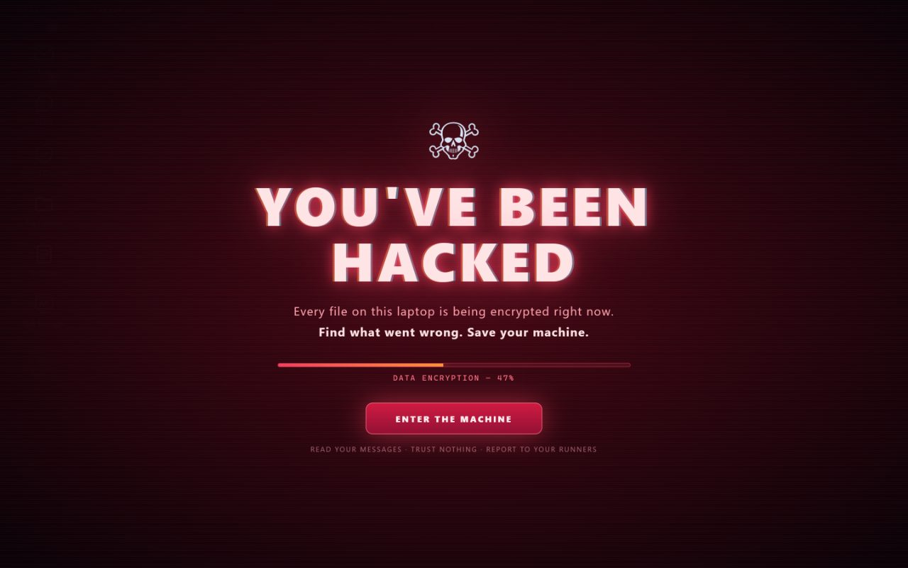
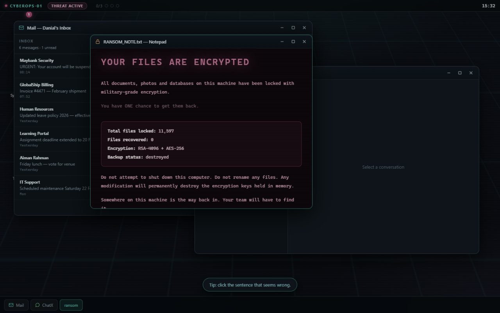
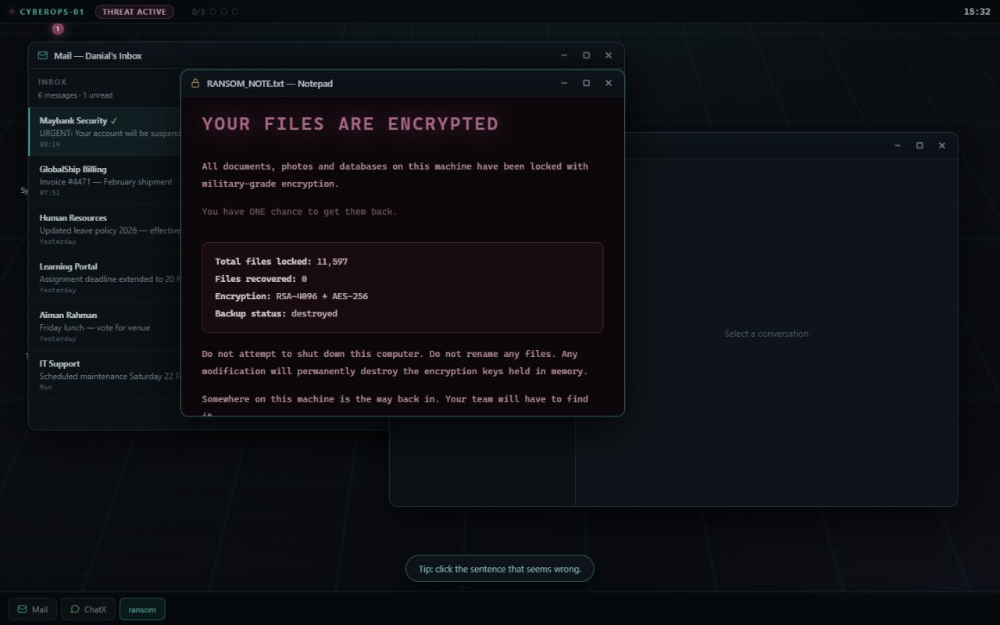
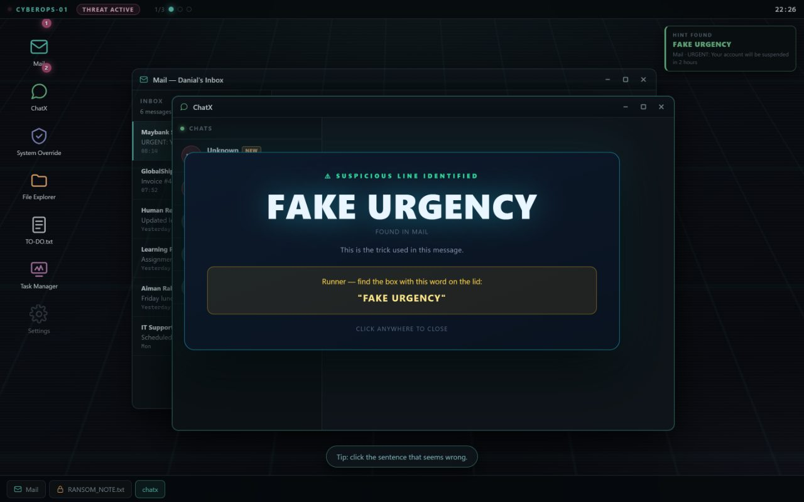
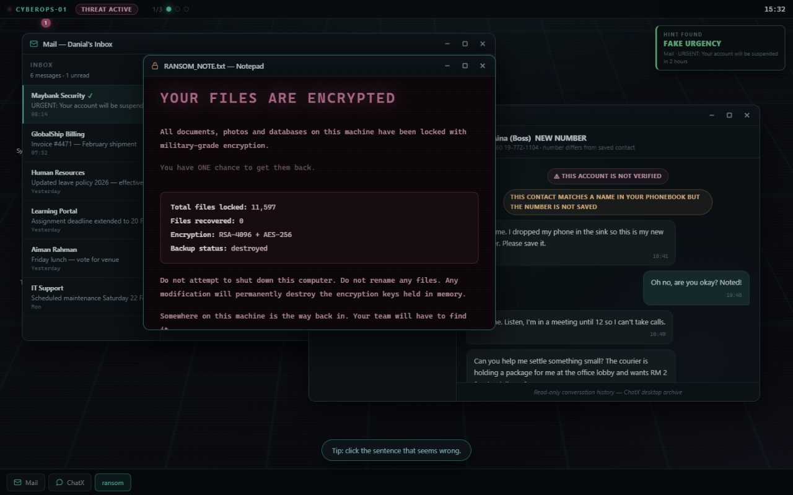
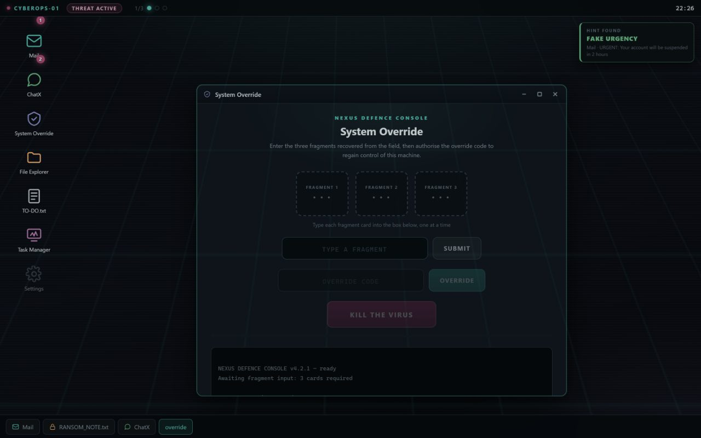
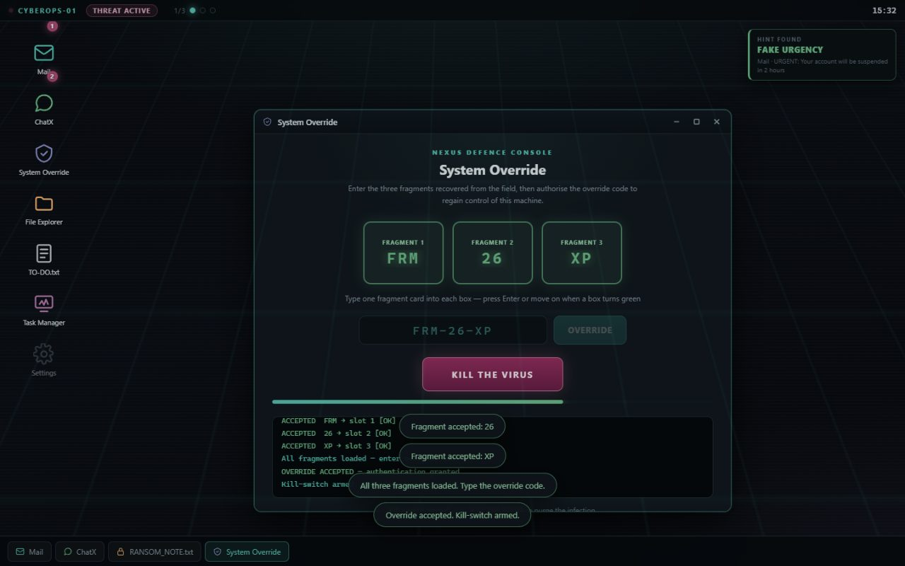
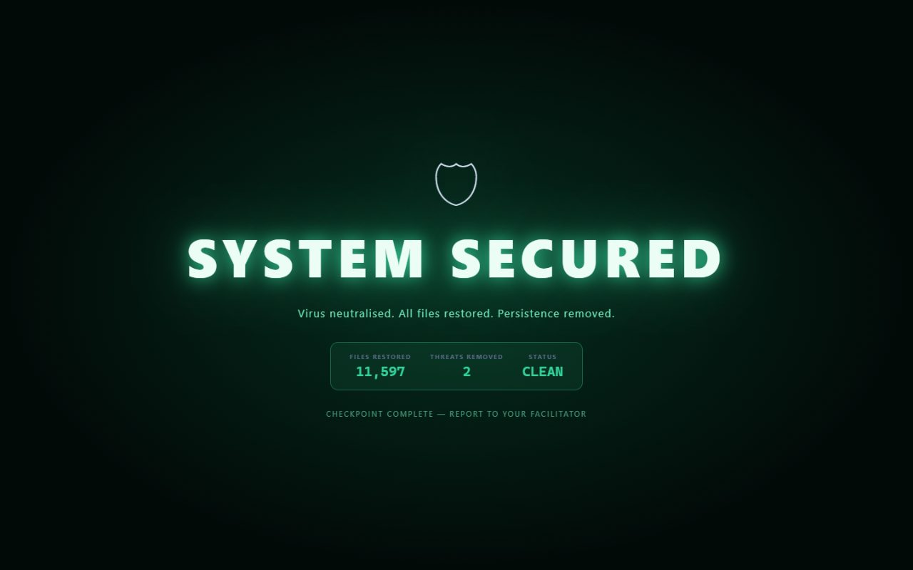
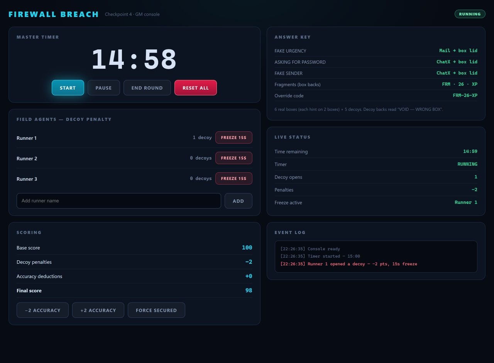

# Firewall Breach Ops

A physical + digital escape-room checkpoint for a cyber-security explorace.

Cyber Analysts sit at a fake infected laptop, read emails and chat messages, click the sentence that is a trick, and shout the hint word to Field Agents — who run to physical boxes and bring back password fragments.

**Live:** https://allyhtml.github.io/firewall-breach-ops/

---

## Screens

| | |
|---|---|
|  |  |
| BIOS boot | "You've been hacked" takeover |
|  |  |
| Infected desktop | Mail — the phishing email |
|  |  |
| Hint card (the shout word) | ChatX — fake boss |
|  |  |
| System Override — fragments | Override accepted, kill armed |
|  |  |
| Purge sequence | SYSTEM SECURED |
|  | |
| GM console | |

---

## Play it

Two ways to run it — the app auto-detects which mode it's in.

| Mode | Start with | GM console runs on |
|---|---|---|
| **Server** (recommended) | double-click `START GAME.bat` | **your phone** — scan the QR in the terminal |
| **Static** | open `index.html` | the same browser, second tab |
| **Offline** | `dist/firewall-breach.html` | `#gm` route (same browser only) |

```
Game        index.html
GM console  gm.html          passphrase gm2026
Server      tools/server.py  port 7331, stdlib only
```

In server mode the laptop and the phone share state through the Python server, so all GM controls (timer, decoy freeze, force-secure, reset) work from the phone. The laptop's bottom-right **timer card** shows a green dot when the link is live and red *No GM link* when it isn't.

> Phone setup: turn on Windows **Mobile hotspot**, join it with the phone, run `START GAME.bat`, allow Python on **Private** networks.

---

## The checkpoint

**Duration:** 15 minutes · **Roles:** 1–2 analysts, 2–3 runners

```
Boot → "YOU'VE BEEN HACKED" → read Mail + ChatX → click the trick line
     → hint word appears → runners open the matching box → 3 fragments
     → enter FRM + 26 + XP → FRM-26-XP → KILL THE VIRUS → SYSTEM SECURED
```

### The three tricks

| Message | Suspicious line | Hint word |
|---|---|---|
| Mail — "account suspended in 2 hours" | "respond with your updated banking information before 2PM" | **FAKE URGENCY** |
| ChatX — "this is Maybank" | "send us the 6-digit code we just SMSed you" | **ASKING FOR PASSWORD** |
| ChatX — "Aina (Boss)" new number | "pay RM2 at homerr-clone.site/track" | **FAKE SENDER** |

**Fragments:** `FRM` · `26` · `XP` → code **`FRM-26-XP`**

### The boxes

6 real (each hint printed on 2 boxes) + 5 decoys = 11 transparent containers.
Print `docs/BOX_LABELS.pdf`, tape front to the lid and back inside.

---

## Docs

- [`docs/GM_BRIEF.md`](docs/GM_BRIEF.md) — full rules, answer key, scoring, debrief
- [`docs/FACILITATOR_RUNSHEET.md`](docs/FACILITATOR_RUNSHEET.md) — one-page checklist to run the station
- [`docs/BOX_LABELS.pdf`](docs/BOX_LABELS.pdf) — print-ready box labels

---

## Build

No dependencies. Everything is plain HTML/CSS/JS (and one stdlib Python server).

```bash
# run the game + phone GM locally
python tools/server.py

# regenerate the printable box labels (pure-stdlib Python)
python tools/make_labels.py

# rebuild the offline single-file bundle
node tools/bundle.js
```

### Project layout

```
START GAME.bat    start server + open the game (recommended)
index.html        game shell (GitHub Pages root)
gm.html           GM console
css/              desktop.css / apps.css / animations.css
js/               icons / data (answer key) / sync / wm / ui
js/apps/          mail / chatx / override / atmos
tools/            server.py / make_labels.py / bundle.js
docs/             briefs + printable labels
dist/             offline single-file build
```

---

## Behavior notes

- **Hints** are the only thing that unlocks box knowledge — nothing about the boxes exists in the page until an analyst clicks the correct sentence.
- **Wrong clicks** are free twice per message, then the message locks for 5 seconds.
- **Decoys** are logged by the GM console, which pushes a 10-second full-screen freeze to the game laptop and deducts 2 points.
- **Fragments** can be entered in any order; the code field stays locked until all three are loaded.
- **KILL THE VIRUS** stays disabled until the override code is accepted.

## Configuration

Change these in `js/data.js`:

```js
fragments      // the three fragment strings
overrideCode   // the combined code
mails / chats  // messages; a trap line is { cls:"trap", hint:"...", text:"..." }
```

GM passphrase is the `PASS` constant in `gm.html` (and is baked into `dist/` on rebuild).
Timer length is set in `gm.html` (`15 * 60 * 1000`).

